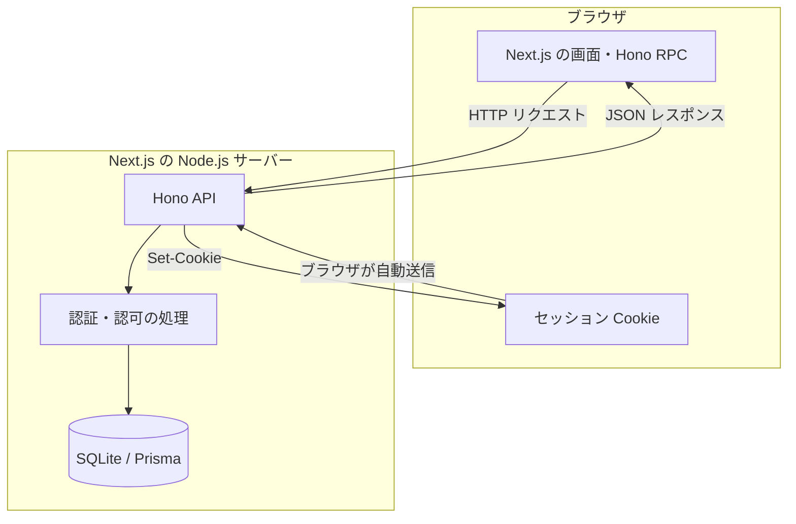

# 準備：テンプレートを動かす

[← はじめに](introduction.md) · [目次](README.md) · [第1章 認証のないアプリを調べる →](01-understanding-the-app.md)

## 配布時に用意されているもの

- メモ一覧・作成・編集の画面。
- メモのCRUDを行うHono API。
- ブラウザからHono RPCでAPIを呼び出す接続。
- PrismaとSQLiteの接続。
- `Note` モデルと初期のマイグレーション。
- 共通の入力欄・ボタン。
- テストの実行環境。

`User`・`Session` モデル、認証API、ハッシュ関数は、この教材の課題で追加します。

## 構成を確認する

Next.jsの中にHono APIを配置し、画面もAPIも `http://localhost:3000` から利用します。APIのパスは `/api` で始まります。



図のCookieと認証・認可の処理は、後の章で追加します。配布時のメモAPIはPrismaを通してDBを操作します。

Hono RPCは、APIの入力・出力の型をクライアントで利用するための仕組みです。リクエストの入力内容はHono側で検証します。アクセス権限の検証は第5章で追加します。

`src/server/app.ts` の `basePath("/api")` に対応して、画面からのメモ一覧取得は `client.api.notes.$get()` と書きます。ブラウザ用クライアントは `src/lib/api-client.ts` の `client` です。

参考：[HonoとNext.jsの接続][ref-hono-next]、[Hono RPC][ref-hono-rpc]

## 主に使うファイル

次のファイルを使います。「第○章で追加」とあるファイルは、生徒がその章で作成します。

| パス | 役割 |
| --- | --- |
| `src/app/` | 画面とフォーム |
| `src/app/api/[[...route]]/route.ts` | Next.jsからHonoへの入り口 |
| `src/lib/api-client.ts` | ブラウザ用のHono RPCクライアント |
| `src/server/app.ts` | HonoのAPIをまとめる場所 |
| `src/server/routes/notes.ts` | メモAPI |
| `src/server/validation/note.ts` | メモの入力ルール |
| `src/server/db/client.ts` | Prismaクライアントの生成・接続 |
| `src/server/routes/auth.ts` | 第2章以降で追加する認証API |
| `src/server/auth/password.ts` | 第2章で追加するパスワード処理 |
| `src/server/auth/session.ts` | 第4章で追加するセッション処理 |
| `src/server/middleware/require-user.ts` | 第5章で追加する認証必須処理 |
| `src/server/middleware/check-origin.ts` | 第7章で追加する送信元確認 |
| `prisma/schema.prisma` | DBのモデル |
| `prisma/migrations/` | DB構造の変更履歴 |
| `prisma/seed.ts` | 初期メモを作成する処理 |
| `prisma.config.ts` | Prisma CLIの接続先・スキーマ・マイグレーション設定 |
| `src/generated/prisma/` | コマンドで生成されるPrismaクライアント |
| `tests/` | DB・APIのテストとテスト用の準備 |

パスワードやDBを扱う処理はサーバー側に置きます。ブラウザ側はAPIの公開型を参照し、必要なデータをリクエストします。

## 環境とリポジトリを準備する

Node.jsは **24系**、pnpmは **10.34.9** を使います。Next.jsは16.4.6、Honoは4.13.19、Prismaは7.10.1に固定しています。依存関係の一覧は[package.json](../package.json)を参照してください。

講師から案内されたGitHubアカウントで、リポジトリを取得します。

```bash
git clone https://github.com/hellososhi/web-auth-hands-on.git
cd web-auth-hands-on
node --version
pnpm --version
```

以後のコマンドは、`package.json` があるリポジトリのルートで実行します。

## 起動する

```bash
pnpm install
pnpm db:setup
pnpm dev
```

`pnpm db:setup` は、`.env` がなければ `.env.example` から作り、Prismaクライアントの生成、既存マイグレーションの適用、サンプルメモの追加を順に行います。メモが1件でもあれば、サンプル追加はスキップします。

接続先はルートの `.env` にある `DATABASE_URL` です。既定値 `file:./prisma/dev.db` は、リポジトリのルートから見た `prisma/dev.db` を指します。DBコマンドが表示する絶対パスで対象を確認できます。Prisma CLIの設定は `prisma.config.ts`、生成先は `src/generated/prisma/` です。

ブラウザで `http://localhost:3000` を開き、メモを作成・編集・削除してください。開発者ツールのNetworkタブで、操作ごとのリクエストを確認します。

稼働確認用の `http://localhost:3000/api/health` を開くと、`{"status":"ok"}` が返ります。教材ではポート3000を使います。他の開発サーバーが使っている場合は、そのサーバーを停止してから起動してください。

`.env` の `APP_ORIGIN="http://localhost:3000"` は第7章で使います。配布時のAPIにはOrigin検証や認証処理はありません。

> TODO（教材整備）：Node.js・pnpmを新しく導入する生徒向けの環境準備の補足と、起動時の画面例を追加する。

## 配布時のメモAPI

| API | 成功時の応答 |
| --- | --- |
| `GET /api/health` | `200`、`{ "status": "ok" }` |
| `GET /api/notes` | `200`、`{ notes }` |
| `POST /api/notes` | `201`、`{ note }` |
| `GET /api/notes/:id` | `200`、`{ note }` |
| `PATCH /api/notes/:id` | `200`、`{ note }` |
| `DELETE /api/notes/:id` | `204`、本文なし |

`note` の公開項目は `id`・`title`・`body` です。作成と更新ではJSONで `title` と `body` を送ります。タイトルは前後の空白を除いて1〜100文字、本文は0〜10,000文字とし、余分な項目は拒否します。更新も両方の項目を送る仕様です。

初期状態では全員がすべてのメモを操作できます。[完成時のAPI仕様](appendices/api-spec.md)にある認証と所有者の確認は、各章で実装します。

## よく使うコマンド

| コマンド | 内容 |
| --- | --- |
| `pnpm dev` | 開発サーバーを起動する |
| `pnpm db:setup` | 環境設定・クライアント生成・既存マイグレーション適用・サンプル追加 |
| `pnpm db:migrate --name add-users` | スキーマの差分からマイグレーションを作成・適用し、クライアントを再生成する |
| `pnpm db:generate` | スキーマに合わせてPrismaクライアントを生成する |
| `pnpm db:seed` | クライアントを生成し、サンプル追加処理を実行する |
| `pnpm db:studio` | Prisma StudioでDBを確認する |
| `pnpm db:reset` | 確認後、既存マイグレーションから開発DBを作り直し、クライアント生成・サンプル追加を行う |
| `pnpm test` | クライアントを生成し、テストを1回実行する |
| `pnpm test:watch` | ファイルの変更に合わせてテストを再実行する |
| `pnpm typecheck` | 生成コードを更新し、TypeScriptの型を確認する |
| `pnpm build` | Prismaクライアントを生成し、Next.jsをビルドする |

`db:setup` は保存済みのマイグレーションを適用します。自分で `schema.prisma` を変更したときは、`db:migrate` で変更履歴を作成します。`add-users` は変更内容に合わせて付ける名前です。

## 教材用データとテスト用データ

演習には架空のユーザーと練習用のパスワードを使います。

開発用DBは、既定では `prisma/dev.db` です。初期化するときは開発サーバーとPrisma Studioを止め、ターミナルで `pnpm db:reset` を実行します。表示された接続先を確認し、`RESET` と入力するとデータを削除して作り直します。このコマンドが初期化できるのは、既定の `prisma/dev.db` だけです。

付属のAPIテストは `tests/helpers/database.ts` を使い、OSの一時フォルダーにテスト専用SQLiteを作成します。マイグレーションの適用と終了時の削除も行うため、開発用DBを使わずに実行できます。

配布時は `tests/notes.test.ts` に公開メモAPIのテストが5件あります。パスワード・セッション・認可のテストは各章で追加します。テストの読み方は[付録A](appendices/testing.md)を参照してください。

---

[← はじめに](introduction.md) · [目次](README.md) · [第1章 認証のないアプリを調べる →](01-understanding-the-app.md)

[ref-hono-next]: https://hono.dev/docs/getting-started/nextjs
[ref-hono-rpc]: https://hono.dev/docs/guides/rpc
