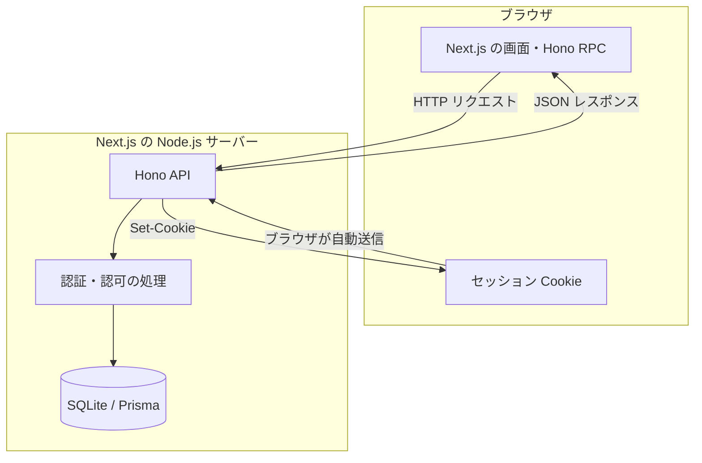

# 準備：テンプレートを動かす

[← はじめに](introduction.md) · [目次](README.md) · [第1章 認証のないアプリを調べる →](01-understanding-the-app.md)

## 配布時に用意されているもの

- メモ一覧・作成・編集の画面。
- メモのCRUDを行うHono API。
- ブラウザからHono RPCでAPIを呼び出す接続。
- PrismaとSQLiteの接続。
- `Note` モデルと初期のマイグレーション。
- 共通の入力欄・ボタン。
- テストの実行環境。

`User`・`Session` モデル、認証API、ハッシュ関数は、この教材の課題で追加します。

## 構成を確認する

Next.jsの中にHono APIを配置し、画面もAPIも `http://localhost:3000` から利用します。APIのパスは `/api` で始まります。



図のCookieと認証・認可の処理は、後の章で追加します。配布時のメモAPIはPrismaを通してDBを操作します。

Hono RPCは、APIの入力・出力の型をクライアントで利用するための仕組みです。リクエストの入力内容はHono側で検証します。アクセス権限の検証は第5章で追加します。

`src/server/app.ts` の `basePath("/api")` に対応して、画面からのメモ一覧取得は `client.api.notes.$get()` と書きます。ブラウザ用クライアントは `src/lib/api-client.ts` の `client` です。

参考：[HonoとNext.jsの接続][ref-hono-next]、[Hono RPC][ref-hono-rpc]

## 主に使うファイル

次のファイルを使います。「第○章で追加」とあるファイルは、生徒がその章で作成します。

| パス | 役割 |
| --- | --- |
| `src/app/` | 画面とフォーム |
| `src/app/api/[[...route]]/route.ts` | Next.jsからHonoへの入り口 |
| `src/lib/api-client.ts` | ブラウザ用のHono RPCクライアント |
| `src/server/app.ts` | HonoのAPIをまとめる場所 |
| `src/server/routes/notes.ts` | メモAPI |
| `src/server/validation/note.ts` | メモの入力ルール |
| `src/server/db/client.ts` | Prismaクライアントの生成・接続 |
| `src/server/routes/auth.ts` | 第2章以降で追加する認証API |
| `src/server/auth/password.ts` | 第2章で追加するパスワード処理 |
| `src/server/auth/session.ts` | 第4章で追加するセッション処理 |
| `src/server/middleware/require-user.ts` | 第5章で追加する認証必須処理 |
| `src/server/middleware/check-origin.ts` | 第7章で追加する送信元確認 |
| `prisma/schema.prisma` | DBのモデル |
| `prisma/migrations/` | DB構造の変更履歴 |
| `prisma/seed.ts` | 初期メモを作成する処理 |
| `prisma.config.ts` | Prisma CLIの接続先・スキーマ・マイグレーション設定 |
| `src/generated/prisma/` | コマンドで生成されるPrismaクライアント |
| `tests/` | DB・APIのテストとテスト用の準備 |

パスワードやDBを扱う処理はサーバー側に置きます。ブラウザ側はAPIの公開型を参照し、必要なデータをリクエストします。

## Node.jsとpnpmを導入する

Node.jsは **24系**、pnpmは **10.34.9** を使います。テンプレートの `.node-version` と `.nvmrc` には、確認に使った **24.22.3** を記録しています。ここではWindows・macOSに初めて導入する手順を説明します。

- **Node.js**：JavaScriptで書かれた開発ツールやサーバーを動かす実行環境。
- **npm**：Node.jsの公式インストーラーに含まれるパッケージ管理ツール。今回はpnpmの導入に使う。
- **pnpm**：教材のライブラリを導入し、`pnpm dev` などのコマンドを実行するツール。

### 1. 既に入っているか確認する

Windowsはスタートメニューから「コマンドプロンプト」、macOSは「ターミナル」を開きます。コマンドは1行ずつ入力し、Enterキーで実行します。この導入作業は、リポジトリを取得する前に進められます。

```shell
node --version
npm --version
pnpm --version
```

`node` が `v24.` で始まり、`npm` のバージョンが表示され、`pnpm` が `10.34.9` なら、[リポジトリの取得](#リポジトリを取得する)へ進めます。「見つからない」「認識されていない」と表示されたツールは、次の手順で導入します。

既にnvm・fnm・VoltaなどでNode.jsを管理している人は、そのツールで24系へ切り替えてください。既存の管理ツールを使い続け、手順3から進めます。

### 2. Node.jsを導入する

**Windows**

1. [Node.js 24.22.3の公式ダウンロードページ][ref-node-download]を開きます。
2. 「Installer Packages」から、通常のIntel・AMDのPCなら `node-v24.22.3-x64.msi`、Arm版Windowsなら `node-v24.22.3-arm64.msi` を選びます。PCの種類は「設定 → システム → バージョン情報 → システムの種類」で確認できます。
3. ダウンロードした `.msi` を開き、画面に従ってインストールします。`npm package manager` と `Add to PATH` は有効にします。追加のネイティブビルドツールを自動導入する項目は、初回の準備では選択不要です。
4. コマンドプロンプトを閉じ、新しく開き直します。VS Codeを使っている場合は、VS Codeも再起動します。

**macOS**

1. [Node.js 24.22.3の公式ダウンロードページ][ref-node-download]を開きます。
2. 「Installer Packages」から `node-v24.22.3.pkg` を選びます。このインストーラーはApple SiliconとIntelの両方に対応しています。
3. ダウンロードした `.pkg` を開き、画面に従ってインストールします。
4. ターミナルを閉じ、新しく開き直します。VS Codeを使っている場合は、VS Codeも再起動します。

導入後、次を実行します。

```shell
node --version
npm --version
```

`node` は `v24.22.3`、`npm` はバージョン番号が表示されれば準備できています。教材のNode.jsの指定は24系です。公式サイトの別のページから取得する場合も、バージョン欄で24系を選んでください。

参考：[Node.jsとnpmの導入][ref-npm-install]

### 3. pnpmを導入する

`npm` を使い、教材で使うバージョンを指定して導入します。

```shell
npm install --global pnpm@10.34.9
pnpm --version
```

`10.34.9` と表示されれば完了です。`--global` は、このPCの複数の作業フォルダーからpnpmコマンドを使えるようにする指定です。

この後、教材の依存関係には `pnpm install` を使います。`pnpm-lock.yaml` に記録されたバージョンをそろえるため、教材内のパッケージ管理はpnpmに統一します。

参考：[pnpmの導入（npmを使う方法）][ref-pnpm-install]

### 導入でつまずいたとき

**`node`・`npm`・`pnpm` が見つからない**

ターミナルとVS Codeを開き直して、バージョン確認をやり直します。PATHは、コマンドを探すフォルダーの一覧です。インストールでPATHが更新されても、開いているターミナルには反映されないことがあります。

pnpmだけが見つからない場合は、`npm config get prefix` で導入先を確認します。Windowsではそのフォルダー、macOSではその中の `bin` が、コマンドを探す対象になります。別のNode.jsが表示される場合は、Windowsでは `where.exe node`、macOSでは `which node` で実行しているファイルの場所を確認してください。

**WindowsのPowerShellで「スクリプトの実行が無効」と表示される**

コマンドプロンプトで同じ手順を実行できます。PowerShellを続けて使う場合は、`npm.cmd install --global pnpm@10.34.9`、`pnpm.cmd --version` のように `.cmd` を付けて実行します。教材の `pnpm dev` なども `pnpm.cmd dev` と書けます。

**macOSでpnpmの導入時に `EACCES` と表示される**

公式の `.pkg` でNode.jsを導入した場合は、npmのグローバル導入先への書き込み権限が原因になることがあります。自分のホームフォルダー内へ導入先を変更します。次はmacOSの標準シェルであるzsh向けの手順です。

```sh
npm config set prefix "$HOME/.local"
mkdir -p "$HOME/.local/bin"
printf '\nexport PATH="$HOME/.local/bin:$PATH"\n' >> "$HOME/.zshrc"
export PATH="$HOME/.local/bin:$PATH"
npm install --global pnpm@10.34.9
pnpm --version
```

最初の行は、今後npmでグローバルに導入するツールの保存先も変更します。`.zshrc` への追記で、新しく開くターミナルでもその場所を参照できます。この設定は一度行えば使い続けられます。既にNode.jsのバージョン管理ツールを使っている場合は、そのツールの設定で導入先を確認してください。

参考：[npmの権限エラーへの対処][ref-npm-permissions]

### 導入の完了条件

- [ ] `node --version` が `v24.` で始まる。
- [ ] `npm --version` がバージョン番号を返す。
- [ ] `pnpm --version` が `10.34.9` を返す。

## リポジトリを取得する

Next.jsは16.4.6、Honoは4.13.19、Prismaは7.10.1に固定しています。依存関係の一覧は[package.json](../package.json)を参照してください。

この手順ではGitを使います。`git --version` でバージョンが表示されることを確認し、講師から案内されたGitHubアカウントでリポジトリを取得します。

```bash
git clone https://github.com/hellososhi/web-auth-hands-on.git
cd web-auth-hands-on
```

以後のコマンドは、`package.json` があるリポジトリのルートで実行します。

## 起動する

```bash
pnpm install
pnpm db:setup
pnpm dev
```

`pnpm db:setup` は、`.env` がなければ `.env.example` から作り、Prismaクライアントの生成、既存マイグレーションの適用、サンプルメモの追加を順に行います。メモが1件でもあれば、サンプル追加はスキップします。

接続先はルートの `.env` にある `DATABASE_URL` です。既定値 `file:./prisma/dev.db` は、リポジトリのルートから見た `prisma/dev.db` を指します。DBコマンドが表示する絶対パスで対象を確認できます。Prisma CLIの設定は `prisma.config.ts`、生成先は `src/generated/prisma/` です。

ブラウザで `http://localhost:3000` を開き、メモを作成・編集・削除してください。開発者ツールのNetworkタブで、操作ごとのリクエストを確認します。

稼働確認用の `http://localhost:3000/api/health` を開くと、`{"status":"ok"}` が返ります。教材ではポート3000を使います。他の開発サーバーが使っている場合は、そのサーバーを停止してから起動してください。

`.env` の `APP_ORIGIN="http://localhost:3000"` は第7章で使います。配布時のAPIにはOrigin検証や認証処理はありません。

> TODO（教材整備）：起動時の画面例を追加する。

## 配布時のメモAPI

| API | 成功時の応答 |
| --- | --- |
| `GET /api/health` | `200`、`{ "status": "ok" }` |
| `GET /api/notes` | `200`、`{ notes }` |
| `POST /api/notes` | `201`、`{ note }` |
| `GET /api/notes/:id` | `200`、`{ note }` |
| `PATCH /api/notes/:id` | `200`、`{ note }` |
| `DELETE /api/notes/:id` | `204`、本文なし |

`note` の公開項目は `id`・`title`・`body` です。作成と更新ではJSONで `title` と `body` を送ります。タイトルは前後の空白を除いて1〜100文字、本文は0〜10,000文字とし、余分な項目は拒否します。更新も両方の項目を送る仕様です。

初期状態では全員がすべてのメモを操作できます。[完成時のAPI仕様](appendices/api-spec.md)にある認証と所有者の確認は、各章で実装します。

## よく使うコマンド

| コマンド | 内容 |
| --- | --- |
| `pnpm dev` | 開発サーバーを起動する |
| `pnpm db:setup` | 環境設定・クライアント生成・既存マイグレーション適用・サンプル追加 |
| `pnpm db:migrate --name add-users` | スキーマの差分からマイグレーションを作成・適用し、クライアントを再生成する |
| `pnpm db:generate` | スキーマに合わせてPrismaクライアントを生成する |
| `pnpm db:seed` | クライアントを生成し、サンプル追加処理を実行する |
| `pnpm db:studio` | Prisma StudioでDBを確認する |
| `pnpm db:reset` | 確認後、既存マイグレーションから開発DBを作り直し、クライアント生成・サンプル追加を行う |
| `pnpm test` | クライアントを生成し、テストを1回実行する |
| `pnpm test:watch` | ファイルの変更に合わせてテストを再実行する |
| `pnpm typecheck` | 生成コードを更新し、TypeScriptの型を確認する |
| `pnpm build` | Prismaクライアントを生成し、Next.jsをビルドする |

`db:setup` は保存済みのマイグレーションを適用します。自分で `schema.prisma` を変更したときは、`db:migrate` で変更履歴を作成します。`add-users` は変更内容に合わせて付ける名前です。

## 教材用データとテスト用データ

演習には架空のユーザーと練習用のパスワードを使います。

開発用DBは、既定では `prisma/dev.db` です。初期化するときは開発サーバーとPrisma Studioを止め、ターミナルで `pnpm db:reset` を実行します。表示された接続先を確認し、`RESET` と入力するとデータを削除して作り直します。このコマンドが初期化できるのは、既定の `prisma/dev.db` だけです。

付属のAPIテストは `tests/helpers/database.ts` を使い、OSの一時フォルダーにテスト専用SQLiteを作成します。マイグレーションの適用と終了時の削除も行うため、開発用DBを使わずに実行できます。

配布時は `tests/notes.test.ts` に公開メモAPIのテストが5件あります。パスワード・セッション・認可のテストは各章で追加します。テストの読み方は[付録A](appendices/testing.md)を参照してください。

---

[← はじめに](introduction.md) · [目次](README.md) · [第1章 認証のないアプリを調べる →](01-understanding-the-app.md)

[ref-hono-next]: https://hono.dev/docs/getting-started/nextjs
[ref-hono-rpc]: https://hono.dev/docs/guides/rpc
[ref-node-download]: https://nodejs.org/en/download/archive/v24.22.3
[ref-npm-install]: https://docs.npmjs.com/downloading-and-installing-node-js-and-npm/
[ref-pnpm-install]: https://pnpm.io/10.x/installation#using-npm
[ref-npm-permissions]: https://docs.npmjs.com/resolving-eacces-permissions-errors-when-installing-packages-globally/
