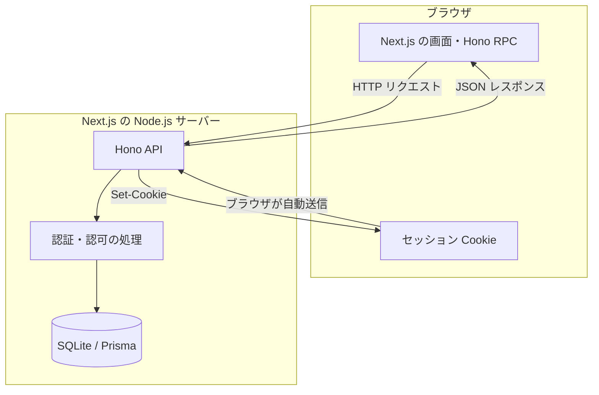

# 準備：テンプレートを動かす

[← はじめに](introduction.md) · [目次](README.md) · [第1章 認証のないアプリを調べる →](01-understanding-the-app.md)

## 配布時に用意されているもの

- メモ一覧・作成・編集の画面。
- メモのCRUDを行うHono API。
- ブラウザからHono RPCでAPIを呼び出す接続。
- PrismaとSQLiteの接続。
- `Note` モデルと初期のマイグレーション。
- 共通の入力欄・ボタン。
- テストの実行環境。

`User`・`Session` モデル、認証API、ハッシュ関数は、この教材の課題で追加します。

## 構成を確認する

Next.jsの中にHono APIを配置し、画面もAPIも `http://localhost:3000` から利用します。APIのパスは `/api` で始まります。



図のCookieと認証・認可の処理は、後の章で追加します。配布時のメモAPIはPrismaを通してDBを操作します。

Hono RPCは、APIの入力・出力の型をクライアントで利用するための仕組みです。リクエストの入力内容はHono側で検証します。アクセス権限の検証は第5章で追加します。

`src/server/app.ts` の `basePath("/api")` に対応して、画面からのメモ一覧取得は `client.api.notes.$get()` と書きます。ブラウザ用クライアントは `src/lib/api-client.ts` の `client` です。

参考：[HonoとNext.jsの接続][ref-hono-next]、[Hono RPC][ref-hono-rpc]

## 主に使うファイル

次のファイルを使います。「第○章で追加」とあるファイルは、生徒がその章で作成します。

| パス | 役割 |
| --- | --- |
| `src/app/` | 画面とフォーム |
| `src/app/api/[[...route]]/route.ts` | Next.jsからHonoへの入り口 |
| `src/lib/api-client.ts` | ブラウザ用のHono RPCクライアント |
| `src/server/app.ts` | HonoのAPIをまとめる場所 |
| `src/server/routes/notes.ts` | メモAPI |
| `src/server/validation/note.ts` | メモの入力ルール |
| `src/server/db/client.ts` | Prismaクライアントの生成・接続 |
| `src/server/routes/auth.ts` | 第2章以降で追加する認証API |
| `src/server/auth/password.ts` | 第2章で追加するパスワード処理 |
| `src/server/auth/session.ts` | 第4章で追加するセッション処理 |
| `src/server/middleware/require-user.ts` | 第5章で追加する認証必須処理 |
| `src/server/middleware/check-origin.ts` | 第7章で追加する送信元確認 |
| `prisma/schema.prisma` | DBのモデル |
| `prisma/migrations/` | DB構造の変更履歴 |
| `prisma/seed.ts` | 初期メモを作成する処理 |
| `prisma.config.ts` | Prisma CLIの接続先・スキーマ・マイグレーション設定 |
| `src/generated/prisma/` | コマンドで生成されるPrismaクライアント |
| `tests/` | DB・APIのテストとテスト用の準備 |

パスワードやDBを扱う処理はサーバー側に置きます。ブラウザ側はAPIの公開型を参照し、必要なデータをリクエストします。

## Node.jsとpnpmを導入する

**fnm（Fast Node Manager）でNode.jsの複数バージョンを管理します。** Node.jsが既に入っているPCにも追加し、教材では **24.22.3**、別のプロジェクトではそのプロジェクトが指定するバージョンへ切り替えます。

- **fnm**：Node.jsのバージョンを追加・切り替えするツール。
- **Node.js**：JavaScriptで書かれた開発ツールやサーバーの実行環境。
- **npm**：Node.jsに付属するパッケージ管理ツール。pnpmの導入に使う。
- **pnpm**：教材の依存関係の導入や、`pnpm dev` などの実行に使う。教材では **10.34.9** にそろえる。

fnmはWindows・macOS・Linuxで使えます。教材の `.node-version` と `.nvmrc` を読み、作業するプロジェクトに合わせてNode.jsを選べます。以下はWindowsとmacOSの手順です。

参考：[fnmの導入とシェル設定][ref-fnm]

### 1. 現在の環境を確認する

Windowsは **PowerShell**、macOSは **ターミナル（zsh）** を開き、現在のバージョンと実行ファイルの場所を控えます。

```shell
node --version
node -p "process.execPath"
```

既存のNode.jsを残したまま、fnmが管理するNode.jsを追加できます。切り替え後に同じコマンドを実行し、使われるNode.jsが変わったことを確かめます。

既にnvmやVoltaなどでバージョンを管理している場合は、その管理ツールで24.22.3を選べます。その場合は、以降とREADMEにあるfnm用の導入・コマンド・完了条件を省略し、手順4のpnpmの準備を進めます。`node --version`・`npm --version`・`pnpm --version`で指定の環境を確認してから、リポジトリを取得してください。以下はfnmを新しく使う人向けです。

### 2. fnmを導入し、ターミナルに設定する

自分のOSの手順を進めます。設定ファイルは、ターミナルを開いたときにコマンドを読み込むためのものです。

**Windows：PowerShell**

まず `winget --version` を実行します。wingetが見つからない場合は、[Microsoft公式の導入手順][ref-winget]で「アプリ インストーラー」を準備します。

```powershell
winget install --id Schniz.fnm --exact
```

導入後はPowerShellを開き直します。VS Codeを使っている場合はVS Codeも再起動し、PowerShellのターミナルを開きます。

```powershell
fnm --version
if (-not (Test-Path -Path $PROFILE)) {
    New-Item -ItemType File -Path $PROFILE -Force | Out-Null
}
notepad $PROFILE
```

開いたファイルの末尾へ、次の1行を追加して保存します。元からある設定は残します。

```powershell
fnm env --use-on-cd --shell powershell | Out-String | Invoke-Expression
```

同じ1行を現在のPowerShellでも実行すると、すぐにfnmを使えます。次回からはプロファイルが読み込まれるときに自動で設定されます。プロファイルの実行が拒否される場合は、後述の「導入でつまずいたとき」を参照してください。

**macOS：ターミナル（zsh）**

`brew --version` を実行します。Homebrewが見つからない場合は、[Homebrew公式ページ][ref-homebrew]の導入手順を進め、最後に表示される `Next steps` のPATH設定も実行します。

```sh
brew install fnm
fnm --version
touch "$HOME/.zshrc"
open -e "$HOME/.zshrc"
```

開いたファイルの末尾へ、次の1行を追加して保存します。既に同じ行がある場合は、その行を使います。

```sh
eval "$(fnm env --use-on-cd --shell zsh)"
```

同じ1行を現在のターミナルでも実行すると、すぐにfnmを使えます。次回からは `.zshrc` の読み込み時に設定されます。PATHを変更する設定がある場合は、その後にfnmの初期化行を置きます。

両OSの `--use-on-cd` は、`cd` で作業フォルダーを変えたとき、そこにあるバージョン指定に合わせてNode.jsを切り替える設定です。

参考：[fnmの自動切り替え][ref-fnm-config]、[PowerShellのプロファイル][ref-powershell-profile]

### 3. 教材のNode.jsを追加して切り替える

ここからは両OSで同じコマンドを使います。

```shell
fnm install 24.22.3
fnm use 24.22.3
fnm current
node --version
node -p "process.execPath"
npm --version
```

`node --version` が `v24.22.3` になり、実行ファイルの場所がfnmの管理先になっていることを確認します。`fnm install` はバージョンの追加、`fnm use` は現在のターミナルで使うバージョンの選択です。

**以前のmacOS向け手順で、npmの導入先を変更した場合**

前の教材にあった `npm config set prefix "$HOME/.local"` を実行した人は、次のコマンドで設定先を確認します。

```shell
npm config get prefix
npm config get userconfig
```

`userconfig` で表示されたファイルをVS Codeなどで開き、前の手順で追加した `prefix=/Users/自分の名前/.local` に相当する行だけを削除して保存します。その後、`npm config get prefix` をもう一度実行し、fnmで選択したNode.jsに対応する導入先になったことを確認します。

これは、今後npmでグローバルに導入するツールの保存先を戻す操作です。既に `~/.local` にあるファイルは残ります。`.zshrc` の `~/.local/bin` のPATH設定は他のツールでも使えるため、そのままにし、fnmの初期化を後に置きます。

参考：[npmの設定][ref-npm-config]、[npmのグローバル導入先][ref-npm-folders]

### 4. 切り替えた環境でpnpmを準備する

`pnpm --version` を実行します。見つからない場合や10.34.9以外の場合は、Node.js 24.22.3を選んだ状態で次を実行します。

```shell
npm install --global pnpm@10.34.9
pnpm --version
```

`10.34.9` と表示されれば完了です。`--global` は、そのnpmのグローバル導入先へpnpmを置く指定です。

Node.jsを切り替えた後は、pnpmのバージョンも確認します。グローバル導入先はOSやnpmの設定に依存し、Windowsでは複数のNode.jsから同じpnpmを使う場合があります。macOSでも、`prefix` を固定していれば導入先が共有されます。

教材の依存関係には `pnpm install` を使います。`pnpm-lock.yaml` に記録されたバージョンをそろえるため、教材内のパッケージ管理はpnpmに統一します。

参考：[pnpmの導入（npmを使う方法）][ref-pnpm-install]

### 5. 複数バージョンを使い分ける

別のプロジェクトでNode.js 22系が必要になった場合の例です。作業中の開発サーバーを止めてから試します。

```shell
fnm install 22
fnm use 22
node --version
fnm list
fnm use 24.22.3
```

`fnm list` で、fnmが管理するバージョンを一覧できます。`fnm use` の切り替えは、そのターミナルに対して行います。既に起動しているサーバーへ反映するには、切り替え後にサーバーを再起動します。

新しいターミナルで使う標準バージョンは `fnm default` で指定します。例えば、普段は22系を使う場合は `fnm default 22` とします。標準バージョンの設定と、プロジェクトの `.node-version` による指定は別の役割です。

導入前に使っていたバージョンを標準にしたい場合は、手順1で控えた番号を `fnm install` と `fnm default` に指定します。

参考：[fnmのコマンド][ref-fnm-commands]

### 導入でつまずいたとき

**`fnm` が見つからない／Node.jsが切り替わらない**

ターミナルとVS Codeを開き直し、手順2の初期化行をそのターミナルで実行してから `fnm use 24.22.3` を試します。`node -p "process.execPath"` で、実行されるNode.jsを確認します。

Windowsでは `Get-Command node,npm,pnpm -All`、macOSでは `type -a node npm pnpm` で候補の場所を調べられます。PATHは、コマンドを探すフォルダーの一覧です。他のNode.js管理ツールの初期化が後から実行されると選択が変わるため、このターミナルではfnmの初期化を使う設定にそろえます。

**PowerShellでプロファイルの実行が拒否される**

その場合は、ターミナルを開くたびに次の初期化行を直接実行してから作業します。そのターミナル内では、フォルダー移動時の切り替えも使えます。

```powershell
fnm env --use-on-cd --shell powershell | Out-String | Invoke-Expression
```

`npm.ps1` や `pnpm.ps1` の実行が拒否される場合は、`npm.cmd install --global pnpm@10.34.9`、`pnpm.cmd --version`、`pnpm.cmd dev` のように `.cmd` を付けます。

**pnpmが見つからない／別のバージョンが動く／権限エラーになる**

`fnm current`、`node -p "process.execPath"`、`npm config get prefix` を確認します。古いNode.jsの実行先や、以前固定したnpmの導入先が残っている場合は、手順2・3の設定を確認してからpnpmを導入し直します。

### 導入の完了条件

- [ ] `fnm list` で24.22.3を確認できる。
- [ ] `fnm current` と `node --version` が24.22.3を示す。
- [ ] `node -p "process.execPath"` がfnmの管理先を示す。
- [ ] `npm --version` がバージョン番号を返す。
- [ ] `pnpm --version` が10.34.9を返す。

## リポジトリを取得する

Next.jsは16.4.6、Honoは4.13.19、Prismaは7.10.1に固定しています。依存関係の一覧は[package.json](../package.json)を参照してください。

この手順ではGitを使います。`git --version` でバージョンが表示されることを確認し、講師から案内されたGitHubアカウントでリポジトリを取得します。

```bash
git clone https://github.com/hellososhi/web-auth-hands-on.git
cd web-auth-hands-on
fnm install
fnm use
node --version
```

以後のコマンドは、`package.json` があるリポジトリのルートで実行します。

バージョンを省略した `fnm install` と `fnm use` は、リポジトリにある `.node-version` を読み、24.22.3を導入・選択します。`.nvmrc` も同じ番号にそろえています。これらは、プロジェクトで使うバージョンを共有するためのファイルです。

手順2の自動切り替えを設定したターミナルでは、次回から `cd` でこのフォルダーへ移動すると、導入済みの24.22.3が選ばれます。バージョン指定ファイルを置くだけで切り替わる仕組みではなく、fnmの初期化がこの動作を担当します。

`node --version` が `v24.22.3`、`pnpm --version` が `10.34.9` であることを確認して、アプリを起動します。

## 起動する

```bash
pnpm install
pnpm db:setup
pnpm dev
```

`pnpm db:setup` は、`.env` がなければ `.env.example` から作り、Prismaクライアントの生成、既存マイグレーションの適用、サンプルメモの追加を順に行います。メモが1件でもあれば、サンプル追加はスキップします。

接続先はルートの `.env` にある `DATABASE_URL` です。既定値 `file:./prisma/dev.db` は、リポジトリのルートから見た `prisma/dev.db` を指します。DBコマンドが表示する絶対パスで対象を確認できます。Prisma CLIの設定は `prisma.config.ts`、生成先は `src/generated/prisma/` です。

ブラウザで `http://localhost:3000` を開き、メモを作成・編集・削除してください。開発者ツールのNetworkタブで、操作ごとのリクエストを確認します。

稼働確認用の `http://localhost:3000/api/health` を開くと、`{"status":"ok"}` が返ります。教材ではポート3000を使います。他の開発サーバーが使っている場合は、そのサーバーを停止してから起動してください。

`.env` の `APP_ORIGIN="http://localhost:3000"` は第7章で使います。配布時のAPIにはOrigin検証や認証処理はありません。

> TODO（教材整備）：起動時の画面例を追加する。

## 配布時のメモAPI

| API | 成功時の応答 |
| --- | --- |
| `GET /api/health` | `200`、`{ "status": "ok" }` |
| `GET /api/notes` | `200`、`{ notes }` |
| `POST /api/notes` | `201`、`{ note }` |
| `GET /api/notes/:id` | `200`、`{ note }` |
| `PATCH /api/notes/:id` | `200`、`{ note }` |
| `DELETE /api/notes/:id` | `204`、本文なし |

`note` の公開項目は `id`・`title`・`body` です。作成と更新ではJSONで `title` と `body` を送ります。タイトルは前後の空白を除いて1〜100文字、本文は0〜10,000文字とし、余分な項目は拒否します。更新も両方の項目を送る仕様です。

初期状態では全員がすべてのメモを操作できます。[完成時のAPI仕様](appendices/api-spec.md)にある認証と所有者の確認は、各章で実装します。

## よく使うコマンド

| コマンド | 内容 |
| --- | --- |
| `pnpm dev` | 開発サーバーを起動する |
| `pnpm db:setup` | 環境設定・クライアント生成・既存マイグレーション適用・サンプル追加 |
| `pnpm db:migrate --name add-users` | スキーマの差分からマイグレーションを作成・適用し、クライアントを再生成する |
| `pnpm db:generate` | スキーマに合わせてPrismaクライアントを生成する |
| `pnpm db:seed` | クライアントを生成し、サンプル追加処理を実行する |
| `pnpm db:studio` | Prisma StudioでDBを確認する |
| `pnpm db:reset` | 確認後、既存マイグレーションから開発DBを作り直し、クライアント生成・サンプル追加を行う |
| `pnpm test` | クライアントを生成し、テストを1回実行する |
| `pnpm test:watch` | ファイルの変更に合わせてテストを再実行する |
| `pnpm typecheck` | 生成コードを更新し、TypeScriptの型を確認する |
| `pnpm build` | Prismaクライアントを生成し、Next.jsをビルドする |

`db:setup` は保存済みのマイグレーションを適用します。自分で `schema.prisma` を変更したときは、`db:migrate` で変更履歴を作成します。`add-users` は変更内容に合わせて付ける名前です。

## 教材用データとテスト用データ

演習には架空のユーザーと練習用のパスワードを使います。

開発用DBは、既定では `prisma/dev.db` です。初期化するときは開発サーバーとPrisma Studioを止め、ターミナルで `pnpm db:reset` を実行します。表示された接続先を確認し、`RESET` と入力するとデータを削除して作り直します。このコマンドが初期化できるのは、既定の `prisma/dev.db` だけです。

付属のAPIテストは `tests/helpers/database.ts` を使い、OSの一時フォルダーにテスト専用SQLiteを作成します。マイグレーションの適用と終了時の削除も行うため、開発用DBを使わずに実行できます。

配布時は `tests/notes.test.ts` に公開メモAPIのテストが5件あります。パスワード・セッション・認可のテストは各章で追加します。テストの読み方は[付録A](appendices/testing.md)を参照してください。

---

[← はじめに](introduction.md) · [目次](README.md) · [第1章 認証のないアプリを調べる →](01-understanding-the-app.md)

[ref-hono-next]: https://hono.dev/docs/getting-started/nextjs
[ref-hono-rpc]: https://hono.dev/docs/guides/rpc
[ref-pnpm-install]: https://pnpm.io/10.x/installation#using-npm
[ref-fnm]: https://github.com/Schniz/fnm
[ref-fnm-config]: https://github.com/Schniz/fnm/blob/master/docs/configuration.md
[ref-fnm-commands]: https://github.com/Schniz/fnm/blob/master/docs/commands.md
[ref-homebrew]: https://brew.sh/
[ref-winget]: https://learn.microsoft.com/en-us/windows/package-manager/winget/
[ref-powershell-profile]: https://learn.microsoft.com/en-us/powershell/module/microsoft.powershell.core/about/about_profiles
[ref-npm-config]: https://docs.npmjs.com/cli/v11/commands/npm-config/
[ref-npm-folders]: https://docs.npmjs.com/cli/v11/configuring-npm/folders/
